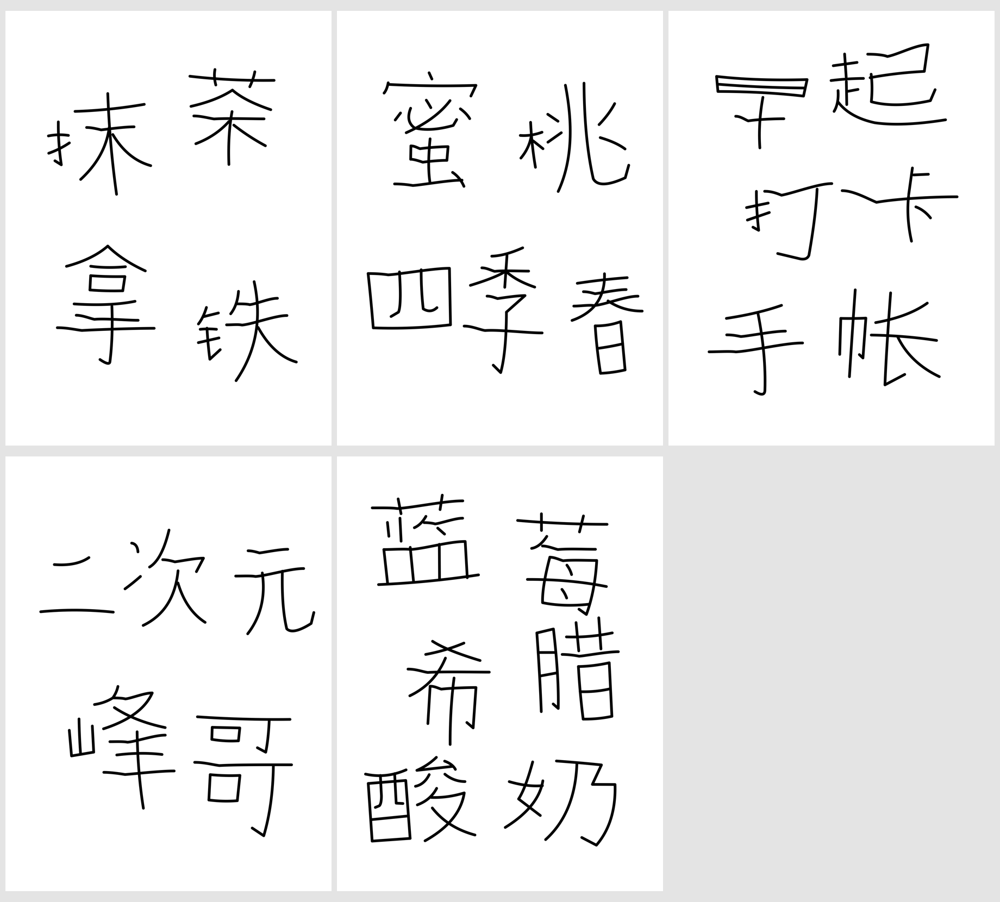

# 喜茶拙趣体 Skill

把中文短词和标题绘制成错落、有趣的矢量手写字，输出可编辑的 SVG。

字形保留清楚的结构关系，同时拉开部件比例；线条粗实、等宽，字与字之间有大小、高低和疏密变化。适合海报标题、手帐、卡片和短句排版。

[下载 Skill ZIP](https://github.com/alexyu1989/skill-heytea-zhuoqu/releases/latest/download/heytea-zhuoqu.zip) · [查看版本](https://github.com/alexyu1989/skill-heytea-zhuoqu/releases) · [反馈问题](https://github.com/alexyu1989/skill-heytea-zhuoqu/issues)

## 效果预览

以下五张均为纯黑色、3:4 竖版，字结构变形强度和排版自由度均为高。



| 文案 | 可编辑矢量 | 白底预览 |
| --- | --- | --- |
| 抹茶拿铁 | [SVG](docs/examples/matcha-latte.svg) | [PNG](docs/examples/matcha-latte.png) |
| 蜜桃四季春 | [SVG](docs/examples/peach-tea.svg) | [PNG](docs/examples/peach-tea.png) |
| 早起打卡手帐 | [SVG](docs/examples/morning-journal.svg) | [PNG](docs/examples/morning-journal.png) |
| 二次元峰哥 | [SVG](docs/examples/anime-feng.svg) | [PNG](docs/examples/anime-feng.png) |
| 蓝莓希腊酸奶 | [SVG](docs/examples/blueberry-yogurt.svg) | [PNG](docs/examples/blueberry-yogurt.png) |

## 安装到 Codex

### 方法一：让 Codex 安装

将下面这段发给 Codex：

```text
$skill-installer
请从下面的 GitHub 目录安装 heytea-zhuoqu skill：
https://github.com/alexyu1989/skill-heytea-zhuoqu/tree/main/skills/heytea-zhuoqu
```

安装完成后，在新一轮对话里输入 `$heytea-zhuoqu` 使用。如果技能列表没有更新，重启 Codex。

### 方法二：下载 ZIP 手动安装

1. 下载上方的 `heytea-zhuoqu.zip`。
2. 解压后得到 `heytea-zhuoqu` 文件夹。
3. 将整个文件夹放到个人技能目录 `~/.agents/skills/`，或某个项目的 `.agents/skills/` 下。

安装后的目录应当是：

```text
~/.agents/skills/heytea-zhuoqu/
├── SKILL.md
├── agents/
├── assets/
├── references/
└── scripts/
```

如果下载的是 GitHub 的 **Source code (zip)**，需要复制其中的 `skills/heytea-zhuoqu` 文件夹。请保留脚本、参考图和示例的完整目录。

已通过 `$skill-installer` 安装时，以安装器返回的目录为准，无需再手动安装一份。

安装与技能发现机制参考 [OpenAI 官方文档](https://learn.chatgpt.com/docs/build-skills)。

### 使用环境

- 支持本地 Skills、文件读写和图片查看的 Codex 环境。
- 使用附带的 SVG 导出脚本时需要 Python 3；脚本仅使用标准库，无需安装第三方 Python 包。
- 字形由模型逐笔设计。效果会随模型和文案变化，首次使用建议从二到六个汉字开始。

## 使用

### 直接生成

```text
用喜茶拙趣体写“抹茶拿铁”。
字结构变形强度高，排版自由度高。
纯黑色，3:4 竖版，透明背景，输出可编辑 SVG。
```

也可以显式调用技能：

```text
$heytea-zhuoqu
写“县城文艺家”，变形强度高，排版自由度中，纯黑色。
```

### 指定分行

```text
用喜茶拙趣体，保持下面的两行：
喜茶拙趣体
skill分享

3:4 竖版，纯黑色，变形强度高，排版自由度高。
字与字有明显的大小、高低和疏密变化。
输出透明底 SVG，并附白底预览。
```

指定分行后，技能保留每行的文字与阅读顺序，在行内安排错落。

### 批量生成

```text
用喜茶拙趣体，分别生成：
抹茶拿铁
蜜桃四季春
早起打卡手帐

每个词单独一张，均为 3:4 竖版、纯黑色。
变形强度高，排版自由度高。
分别提供 SVG，有可用预览工具时同时提供 PNG。
```

### 修改已有作品

直接说明要改的维度，例如：

```text
字改成纯黑色。
```

```text
排版更紧凑，保留单字字形和线条粗细。
```

```text
保持文字和画幅，把排版自由度改为中。
```

## 可调参数

两项强度相互独立，可以用自然语言指定。

| 参数 | 可选值 | 默认 | 影响 |
| --- | --- | --- | --- |
| 字结构变形强度 `deformation_strength` | 低／中／高 | 高 | 字内部件的伸展、收紧、比例反差和重心 |
| 排版自由度 `layout_freedom` | 低／中／高 | 高 | 字间大小、高低、间距、方向与词组轮廓 |
| 文字颜色 | 颜色名称或十六进制值 | `#34332f` | 所有笔画的颜色；纯黑色请指定 `#000000` |
| 画幅与分行 | 例如 3:4、横排、竖排、指定换行 | 按文案构图 | 画布比例及阅读方向 |
| 背景 | 透明或指定颜色 | 透明 | SVG 背景；预览可以另用白底 |

例如，“变形高、排版低”会保留明显的字内比例反差，同时采用更收敛的整体排布。

新稿采用粗实等宽线条。常见设计坐标下的基准线宽为 `6.2`，大字、小字和附带字母共用同一线宽。需要调整时，可以直接说“线条再粗一点”。

## 输出与修改

- 主要交付物是独立的 `.svg` 文件，每个字单独分组，笔画可继续编辑。
- SVG 使用路径绘制，没有字体依赖，也不包含嵌入位图。
- 有可用渲染工具时可附 PNG 预览；导出脚本本身只生成 SVG。
- 适合短词、标题、少量数字和少量附带字母。长篇正文、完整字库和可安装字体文件不在当前范围内。

## 导出脚本

模型可以直接写 SVG，也可以先设计笔画数据，再调用脚本统一导出。脚本负责线宽、分组和长横浅折，不会把任意文本自动转换成新字形。

在仓库根目录执行下面的命令，可以重新导出内置的“早起打卡”示例：

```bash
python3 skills/heytea-zhuoqu/scripts/render_svg.py \
  skills/heytea-zhuoqu/assets/examples/zaoqi.json \
  --out output/zaoqi.svg
```

旧示例保留了原来的细线参数，主要用于参考结构和部件关系；新稿以当前技能说明中的粗细规则为准。

绘图数据格式见 [drawing-format.md](skills/heytea-zhuoqu/references/drawing-format.md)。长横浅折使用固定随机种子，重复导出同一份数据时保持相同结果。两项强度参数需要在设计路径和排版时落实，脚本只校验并记录它们。

## 仓库结构

```text
skill-heytea-zhuoqu/
├── README.md
├── docs/
│   ├── gallery.png           效果总览
│   └── examples/             五组 SVG 和 PNG
└── skills/
    └── heytea-zhuoqu/
        ├── SKILL.md          字形、排版与交付规则
        ├── agents/           技能显示信息
        ├── assets/examples/  已有字形与绘图数据
        ├── references/       结构、粗细和排版参考
        └── scripts/          SVG 导出工具
```

如果发现缺笔、结构不清或排版过齐，可以在 [Issues](https://github.com/alexyu1989/skill-heytea-zhuoqu/issues) 附上文案、使用参数和生成结果，方便复现和改进。
