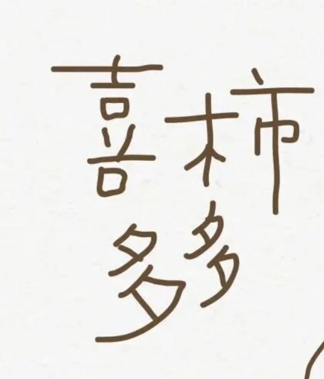
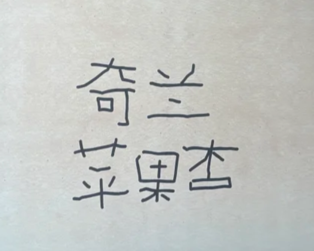
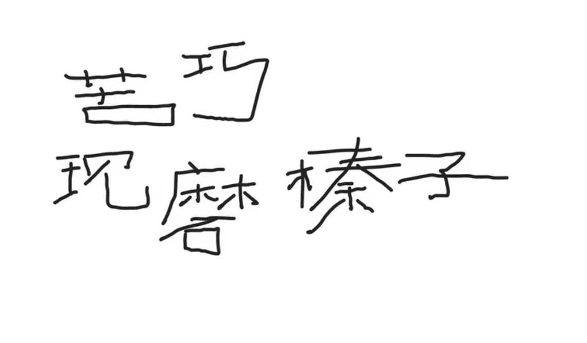

# 粗细与排版参考

用户参考图用于判断笔画重量、字势和词组轮廓。新文案仍需重新设计，图中纸张纹理、颜色与毛边不必复现。

## 粗实线条

看“喜柿多多”中圆润粗实的线条：横、竖、撇、捺的视觉重量接近，细小部件仍有清楚的负形。比旧 SVG 样例更粗，不能沿用细线稿的重量。不同参考图的截图比例不同，应比较线宽与字形的比例，而非截图像素。

## 紧凑但不对齐

上方“奇兰”和下方“苹果杏”的字数、宽高与起止位置不同。“奇”较高，“兰”较扁，底下三个字各有字势；上下行不是五个相同字格。靠不同字形的空处安排疏密，不靠统一加大字距。

“苦”低矮、“巧”抬高，下方的字在不同高度展开；“瑁”下沉，“榛”体量较大，“子”横向舒展。相邻字既有挨近的部位，也有舒开的笔画。轮廓不规则，阅读顺序仍清楚。不要把整行都压成相同宽高、相同倾角，再略微上下挪动。

已有结构参考图 `structure-reference.png` 主要帮助判断部件反差；本页两张布局参考主要帮助判断多字关系。两种尺度都需要成立。
